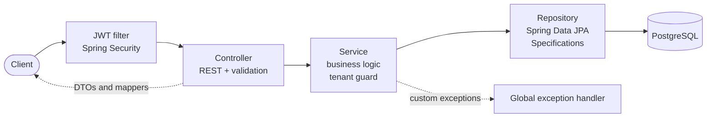

<!-- Profile README for https://github.com/KP-Thakur67 -->

**Java · Spring Boot · REST APIs · Spring Security · JWT · PostgreSQL · Docker**

---

## 👨‍💻 About Me

I'm a Computer Science student who builds **Java backends with Spring Boot**: layered REST APIs, JWT-secured endpoints, JPA data models, and Docker-based setups.

| | |
|---|---|
| 🎯 **Role** | Aspiring Java Backend Developer / Software Engineer |
| 🎓 **Education** | B.Tech Computer Science & Engineering, Sanskriti University (graduating 2027) |
| 📍 **Location** | India |
| 🛠️ **Focus** | REST API design, Spring Security + JWT, PostgreSQL, Docker, clean backend architecture |
| 🔭 **Best examples** | [AI Receptionist backend](https://github.com/KP-Thakur67/ai-receptionist) and [InternVerify](https://github.com/KP-Thakur67/offer-letter-verification-backend) |

## 🧱 Backend Architecture I Build

The [AI Receptionist backend](https://github.com/KP-Thakur67/ai-receptionist) follows this request flow (taken from its actual package structure):

## 🛠️ Technical Skills and Technology Stack

**Core stack, used in my projects**

**Also used in smaller projects**

<b>Text version of the stack</b> (in case icons do not load)

- **Core:** Java, Spring Boot, Spring Security, Spring Data JPA, Maven, PostgreSQL, MySQL (configuration option), Docker, Git, GitHub, IntelliJ IDEA
- **Also used:** Python, TypeScript, HTML, CSS, JavaScript

## ⚙️ Backend Development Skills

| Area | What I have implemented |
|---|---|
| **REST API design** | Resource controllers, request/response DTOs, mappers, pagination, and filtering with JPA Specifications |
| **Security** | Stateless JWT authentication with a Spring Security filter chain, plus role-based access (`ADMIN`, `OWNER`, `DENTIST`, `RECEPTIONIST`) |
| **Backend architecture** | Controller, service, repository, entity, DTO and mapper layers; clinic-scoped (multi-tenant) data access with a tenant guard |
| **Persistence** | Spring Data JPA with PostgreSQL; H2 in-memory for development; MySQL configuration option |
| **Error handling** | Custom exceptions with a global exception handler and a consistent API response format |
| **API documentation** | OpenAPI and Swagger UI through springdoc |
| **Integrations** | Google Gemini API for field extraction, Apache PDFBox for PDF text |
| **Containers** | Multi-stage Dockerfile and Docker Compose with a PostgreSQL 17 service |

## 🧰 Tools and Technologies

## 🚀 Featured Projects

### 🦷 AI Receptionist SaaS: Backend
> Multi-tenant Spring Boot backend for dental clinics: patients, dentists and appointment scheduling.

| ✅ Implemented in the code | 🚧 Not yet in the code |
|---|---|
| Modules for auth, users, clinics, dentists, patients, appointments, dashboard summary and global search | The AI / voice receptionist layer (no AI integration exists in the current source) |
| Four roles and a tenant guard that keeps each clinic's data separate | Automated test suite beyond the default context-load test |
| Appointment statuses (`BOOKED`, `CONFIRMED`, `COMPLETED`, `CANCELLED`, `NO_SHOW`) with conflict detection | |
| Filtering with JPA Specifications, pagination, Swagger UI | |
| Docker Compose for app and database, with a multi-stage Dockerfile | |

🔗 **[View repository](https://github.com/KP-Thakur67/ai-receptionist)**

---

### 🔎 InternVerify: Offer Letter Verification System
> Full-stack app that helps candidates check whether a job offer letter looks genuine.

| ✅ Implemented in the code | 🚧 Planned (listed as future work in the repo) |
|---|---|
| Upload an offer letter PDF, extract its text with PDFBox, then extract fields (company, CIN, email, salary) with the Gemini API | Live MCA API integration (today it checks a bundled registry dataset) |
| Rule-based verification score: company match, email-domain match, salary sanity check, and MCA registry match (CIN or company name) | Advanced AI fraud detection |
| JWT register/login, an admin API for managing companies, public company-search and scam-report endpoints | Cloud deployment (AWS / Render) |
| Plain HTML/CSS/JS frontend served by the app; H2 in-memory database for development | User dashboard and analytics |

🔗 **[View repository](https://github.com/KP-Thakur67/offer-letter-verification-backend)**

---

### 🛡️ Cynbit Backend Audit
> Passive, ethical backend and security review of a public website, written as an internship assessment.

- Findings are labelled **Confirmed**, **Partially verified** or **Hypothesis**, so each claim traces back to evidence.
- Includes a sanitized evidence log and a Spring Boot reference implementation of the recommended fixes. The reference code is illustrative, not the audited site's code.

🔗 **[View repository](https://github.com/KP-Thakur67/cynbit-backend-audit)**

<!--
  TODO: RepoAudit AI - add only after the real repository URL is known.
  ### RepoAudit AI
  > One-line description based on the repository README
  | Implemented | Planned |
  🔗 **[View repository](https://github.com/KP-Thakur67/REPO_NAME)**
-->

## 📊 GitHub Statistics

Cards are generated live by github-readme-stats. If they do not load, see my <a href="https://github.com/KP-Thakur67?tab=repositories">repositories</a> directly.

## 🔥 Contribution Streak

## 🐍 Contribution Snake

<picture>
  <source media="(prefers-color-scheme: dark)" srcset="https://raw.githubusercontent.com/KP-Thakur67/KP-Thakur67/output/github-snake-dark.svg" />
  <source media="(prefers-color-scheme: light)" srcset="https://raw.githubusercontent.com/KP-Thakur67/KP-Thakur67/output/github-snake.svg" />
  
</picture>

## 🏆 Assignments and Case Studies

These are real submissions in my public repositories:

- 🧩 [**Bynry backend case study**](https://github.com/KP-Thakur67/bynry-backend-case-study): backend engineering case study with a code review and debugging section.
- 🛒 [**1Fi Marketplace**](https://github.com/KP-Thakur67/onefi-marketplace): full-stack SDE intern assignment with a TypeScript frontend, REST APIs and PostgreSQL (product variants and EMI plan selection).
- 💸 [**Affiliate Payout System**](https://github.com/KP-Thakur67/affiliate-payout-system): low-level design in Python covering advance payout, reconciliation, withdrawal control and recovery workflow.

<!-- Add certifications here only when you have a verifiable credential link. -->

## 🌱 Currently Learning

- ☁️ Cloud deployment of Spring Boot services (AWS / Render)
- 🧪 Automated testing for service and security layers
- 🧠 LLM agents, through [llm-agent-world-cl](https://github.com/KP-Thakur67/llm-agent-world-cl)
- 📐 Low-level system design patterns

## 🤝 Let's Connect

Open to talking about **Java, Spring Boot and backend engineering**, and to internship or entry-level opportunities.

  

